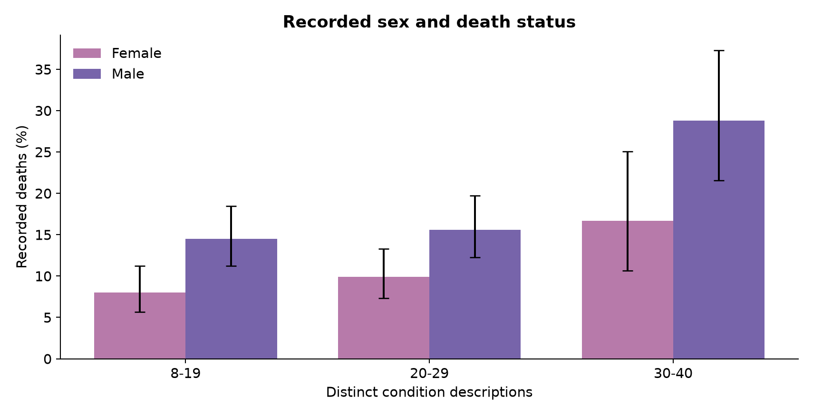

# Synthetic Delaware EHR: condition burden and death status

**Bhakti Doshi · Health Data Science portfolio**

A reproducible Python analysis of **1,753 synthetic patient records** and more than **472,000 condition, medication and encounter rows**. The project links EHR tables, describes recorded death proportions, compares sex and age strata, and examines how regression results change with cohort definition.

[Analysis notebook](notebooks/assessment.ipynb) · [Essay](reports/Essay.pdf) · [Presentation](reports/Presentation.pdf) · [Methods and corrections](reports/CORRECTIONS.md)



## What this project demonstrates

- **Data engineering:** validated joins across four CSV tables, date handling, reproducible extracts and source hashes.
- **Statistical analysis:** Wilson confidence intervals, contingency tests, ratios of death proportions, Holm correction and logistic regression with an interaction term.
- **Critical interpretation:** full-cohort sensitivity analysis, explicit denominators and distinctions between association, prediction and causation.
- **Communication:** an executed notebook, revised essay and 19-slide presentation generated from the same data and outputs.

## Main findings

| Measure | Full export | Original 8-40 condition subset |
| --- | ---: | ---: |
| Records | 1,753 | 1,716 |
| Recorded deaths | 253 | 231 |
| Death proportion | 14.43% | 13.46% |
| Age/sex-adjusted male vs female OR | 1.836 (95% CI 1.378-2.447) | 1.835 (1.362-2.472) |
| Adjusted condition-count OR | 0.967 (0.947-0.988) | 0.983 (0.960-1.007) |
| Sex-by-condition interaction p | 0.855 | 0.847 |

The original restriction excludes **37 records containing 22 deaths**. Condition-count findings change with adjustment and cohort definition. The sex association remains, but these data do not establish its mechanism. There is insufficient evidence of an interaction on the log-odds scale.

These are **synthetic, retrospective associations**, not population estimates for Delaware, causal effects or a validated clinical prediction tool. Death proportions do not account for person-time. Condition counts describe historical diagnoses, not necessarily concurrent chronic multimorbidity.

## Run it

Python **3.12** is the tested version. All required analysis data is included as small compressed extracts; no external download or credentials are required.

```bash
git clone https://github.com/bhaktihdoshi/delaware-ehr-mortality.git
cd delaware-ehr-mortality
python3.12 -m venv .venv
source .venv/bin/activate
python -m pip install -r requirements.txt
python -m unittest discover -s tests -v
python scripts/run_notebooks.py
python scripts/build_reports.py
```

On Windows, activate with `.venv\Scripts\activate` instead. `requirements.txt` pins direct dependencies; `requirements-lock.txt` records the full tested macOS environment and is provided as an environment record, not a cross-platform lockfile.

The notebook runner uses the active environment and a temporary kernel registration. It executes both notebooks from clean kernels, embeds outputs and exports result tables. The report builder regenerates PDFs and supporting figures. GitHub Actions runs the same tests and rebuild steps on Linux.

The default reference date is **2024-10-04**, the latest observed encounter start in the supplied export. It is a documented convention, not a verified simulator end date. To analyse another export, set `EHR_DATA_DIR` and `EHR_REFERENCE_DATE` for the notebooks. The report builder is intentionally bound to the included portfolio data and cutoff; update it before creating reports for a different export.

## Repository guide

| Path | Contents |
| --- | --- |
| `notebooks/assessment.ipynb` | Corrected, executed analysis of the supplied data |
| `notebooks/results_review.ipynb` | Audit of original saved aggregate outputs, clearly labelled as historical |
| `src/analysis.py` | Reusable validation, cohort preparation and statistical functions |
| `data/raw/` | Compressed extracts with all source rows and only required columns |
| `data/manifest.json` | Provenance, row counts and SHA-256 hashes |
| `outputs/` | Tables generated by the corrected rerun |
| `reports/` | Revised essay, presentation, editable text sources and correction log |
| `figures/` | Charts regenerated from the analysis |
| `tests/` | Boundary, uncertainty, multiple-testing and cohort-integrity checks |

## Measurement decisions

The condition intervals are **8-19, 20-29 and 30-40**, matching the original numeric boundaries. The old labels incorrectly assigned boundary values. Actual medication counts replace bin-midpoint estimates, and zero-death groups retain their confidence intervals.

Age at reference is a birth-cohort covariate: for deceased records it represents hypothetical attained age. It is **not age at death or a baseline age in a prospective survival study**. There are 25 recorded deaths before age 20, even though reference ages are approximately 30-75. Historical utilisation can reflect illness near death.

See [data documentation](data/README.md) for field definitions and provenance. The generator version, seed and original download source were not supplied, so the analysis is reproducible on this export but does not claim to regenerate the same synthetic cohort.

## CV wording

> Analysed 1,753 synthetic EHR records in Python, integrating 472k+ clinical-history rows and applying logistic regression, interaction testing and cohort sensitivity analysis; delivered reproducible notebooks, automated checks and research reports.

Only use this wording for work you can explain and substantiate in an interview. This repository is a revised portfolio edition of the original academic assessment. Original submissions remain outside the repository. AI assistance supported the original assessment and this review/refactoring; the essay includes the disclosure.

## Sources

- [Synthea CSV data dictionary](https://github.com/synthetichealth/synthea/wiki/CSV-File-Data-Dictionary)
- [Walonoski et al. (2018), Synthea methods](https://doi.org/10.1093/jamia/ocx079)
- [Fortin et al. (2012), multimorbidity measurement](https://doi.org/10.1370/afm.1337)
- [Crimmins, Shim and Zhang (2019), sex differences in morbidity and mortality](https://doi.org/10.1373/clinchem.2018.288332)

No blanket licence is asserted over source data or third-party material. Attribution and known provenance are documented above.
