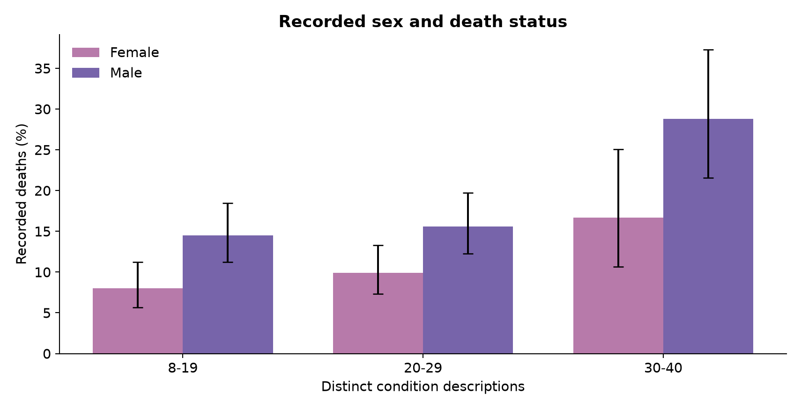
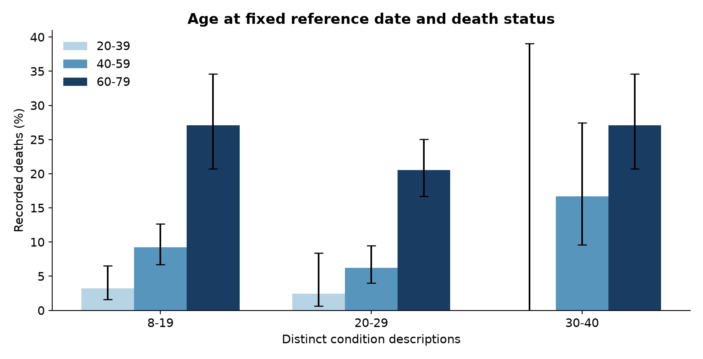

# Recorded condition burden and death status in synthetic Delaware EHR data

Bhakti Doshi | Health Data Science portfolio | Revised 27 September 2026

Abstract

This project examines associations between recorded condition burden, demographic characteristics and death status in a supplied Synthea export for Delaware. The full dataset contains 1,753 synthetic records, including 253 recorded deaths (14.43%). A sensitivity cohort reproduces the original assessment restriction to 8-40 distinct condition descriptions, retaining 1,716 records and 231 deaths (13.46%). Python joins patient, condition, medication and encounter tables, estimates death proportions with Wilson intervals, and fits retrospective logistic models.

The restricted cohort has death proportions of 11.22%, 12.68% and 23.35% for 8-19, 20-29 and 30-40 condition descriptions. The age/sex-adjusted male-versus-female odds ratio is 1.835 in the restricted cohort and 1.836 in the full export. There is insufficient evidence of a sex-by-condition-count interaction on the log-odds scale in either cohort. The adjusted condition-count association differs between cohorts, highlighting sensitivity to exclusions.

These results describe a simulator-generated record history. They do not establish why mortality differs between sexes, validate a clinical risk tool or estimate time-standardised mortality. The main contribution is a reproducible workflow with explicit cohort accounting, uncertainty estimates and transparent limits on interpretation.

Research questions

How does recorded condition burden relate to death status? Does the male-versus-female association persist after adjustment for age at a fixed reference date and condition count? Is there evidence that this association varies with condition count?

Context

Synthea produces realistic but synthetic health records (Walonoski et al., 2018). This permits a demonstration of EHR analysis without using clinical patient records. Operational definitions matter: multimorbidity prevalence varies with the diagnoses and definitions selected (Fortin et al., 2012). This project therefore uses the narrower term recorded condition burden for its history-based count.

## Methods and measurement

Data preparation

The supplied export contains 107,376 condition rows, 191,649 medication rows and 173,900 encounter rows. The repository includes compressed extracts containing only analysis columns. Patient identifiers must be unique, foreign keys must resolve, and required fields and dates must pass validation. Source and extract hashes document provenance. The generator version, generation seed and official simulation end date were not supplied.

The analysis uses 4 October 2024, the latest observed encounter start date, as a fixed reference date. This data-derived cutoff replaces the original notebook's changing computer date. Age at reference is elapsed time from birth to the cutoff. For deceased records, it is hypothetical attained age and functions as a birth-cohort covariate. It is not age at death. Death status indicates a recorded death on or before the cutoff.

Exposure definitions

Condition burden counts distinct diagnosis descriptions across recorded history. This includes historical and potentially non-chronic conditions, and does not establish concurrent chronic multimorbidity. The original numeric bins [8,20), [20,30) and [30,41) are preserved and correctly labelled 8-19, 20-29 and 30-40. Medication burden counts distinct historical medication descriptions, while utilisation counts encounter rows. Neither measure accounts for exposure time.

The export's GENDER field contains F/M values. The analysis describes these recorded sex categories without inferring gender identity. Acute encounters comprise emergency, inpatient and urgent-care classes. Routine encounters comprise ambulatory, outpatient and wellness classes. Shares use acute plus routine encounters as the denominator and report other classes separately. A patient with no eligible encounters receives a missing share rather than zero.

Statistical approach

The full export is the primary descriptive cohort. The 8-40 subset is a sensitivity analysis that permits direct comparison with the assessment. Wilson intervals accompany proportions. Pearson chi-square tests compare death status by sex within condition strata, with Fisher's exact test available for sparse expected counts. Ratios of death proportions use Katz log intervals. Holm correction covers the three sex-stratum comparisons.

Logistic models include an unadjusted condition-count model, an age/sex-adjusted model, a separate sex-by-centered-condition-count interaction model, and an exploratory model adding medication and encounter counts. Each model is fitted to both cohorts. The three acute-share comparisons use Mann-Whitney tests and their own Holm family. Routine shares are complementary and are not tested again. These are exploratory analyses with no held-out predictive validation.

## Cohort accounting and model sensitivity

The full cohort contains 878 male and 875 female records. Restricting condition counts to 8-40 excludes 37 records (2.11%), including 22 deaths (8.70% of all recorded deaths). The excluded group has a death proportion of 59.46%. The overall proportion falls by 0.97 percentage points, from 14.43% to 13.46%. Small cell sizes justify caution, but do not by themselves justify removal or demonstrate improved robustness.

The unadjusted condition-count odds ratio is 1.019 per description in the full export (p = 0.035), compared with 1.039 in the restricted cohort (p < 0.001). After adjustment for age at reference and recorded sex, the full-cohort condition-count coefficient becomes inverse (OR 0.967, p = 0.002). In the restricted cohort it is 0.983 (p = 0.159). The latter does not reach a 5% threshold. This difference makes cohort choice material to the interpretation.

Age/sex-adjusted models

| Predictor | Full export OR (95% CI) | Restricted OR (95% CI) |
| --- | --- | --- |
| Male vs female | 1.836 (1.378-2.447) | 1.835 (1.362-2.472) |
| Age at reference, per year | 1.083 (1.067-1.099) | 1.082 (1.066-1.099) |
| Condition count, per description | 0.967 (0.947-0.988) | 0.983 (0.960-1.007) |

Both models show a positive male-versus-female association and a positive association with age at reference. A one-year coefficient should not be compared directly with a sex-category coefficient to rank predictor importance, because their units differ. Age at reference also does not mean age at death.

In the fully adjusted exploratory model, condition-count odds ratios are 0.891 for the full export and 0.909 for the restricted cohort. Inverse coefficients do not show that accumulating diagnoses protects patients. Correlated histories, record length, survival time and conditioning on utilisation can contribute to the pattern. The model does not isolate any of those mechanisms.

## Condition burden and recorded sex

Within the restricted cohort, the 8-19 group has 83 deaths among 740 records (11.22%), the 20-29 group has 95 among 749 (12.68%), and the 30-40 group has 53 among 227 (23.35%). The highest group has a larger observed proportion, but three grouped estimates do not by themselves establish a nonlinear functional form.

| Condition count | Female deaths / n | Male deaths / n | Ratio | Holm p |
| --- | --- | --- | --- | --- |
| 8-19 | 30 / 374 | 53 / 366 | 1.81 | 0.016 |
| 20-29 | 38 / 384 | 57 / 365 | 1.58 | 0.037 |
| 30-40 | 17 / 102 | 36 / 125 | 1.73 | 0.037 |

The corrected Holm p-values are 0.016, 0.037 and 0.037. All three comparisons remain below 0.05. The lowest-group ratio is 1.81, correcting the essay's 1.83. Groups with the same broad condition-count range may still differ in age, diagnoses and observation history.

The separate interaction model gives OR 0.996 (95% CI 0.951-1.042, p = 0.847) in the restricted cohort and OR 1.004 (0.964-1.045, p = 0.855) in the full export. These results do not support the presentation's claim that increasing burden has a stronger effect in males. A nonsignificant interaction also does not prove identical effects, and this test concerns the log-odds scale rather than absolute differences in death proportions.

## Age, medication history and encounters

Age-stratified proportions generally increase across age bands within a burden stratum. However, these bands describe age at the fixed reference date, not age at death. The full export contains 25 recorded deaths before age 20, despite reference ages of approximately 30-75. It would be misleading to describe the dataset as deaths occurring only among adults aged 20-79.

The youngest high-burden cell contains six records and zero deaths. Its Wilson interval extends from 0% to 39.03%, demonstrating substantial uncertainty. The original notebook hid intervals for zero-death cells. Small race strata create similar limitations, and the race tables support description rather than causal interpretation.

Actual mean medication counts for females versus males are 5.58 versus 3.59 in the lowest burden group, 8.08 versus 8.13 in the middle group, and 11.69 versus 11.38 in the highest group. The original bubble-size calculation used bin midpoints and discarded zero-medication records from that average. Correcting it shows that treatment histories should not simply be described as equal.

In the restricted exploratory model, medication count has OR 1.036 (p = 0.048) and encounter count has OR 1.00458 per encounter (p < 0.001), while the male-versus-female OR remains 1.848. These histories may reflect illness near death and are not baseline exposure measures. Persistence of a coefficient does not rule out mediation or establish why the association exists.

## Exploratory diagnoses and interpretation

Encounter composition

Across the restricted condition strata, acute-share comparisons have Holm-adjusted p-values of 1.000, 0.611 and 1.000. There is insufficient evidence of distributional differences under this comparison family. This is not evidence that access to care, care quality or care-seeking behaviour is equivalent. The full export contains 1,333 encounters classified as other, which are excluded from the acute/routine-share denominator but retained in total encounter counts.

Diagnosis categories

Keyword flags identify diabetes, chronic kidney disease, COPD, cancer-related descriptions, heart failure, stroke and hypertension. Among records with at least one flag, females have 70 deaths among 656 records (10.67%) and males have 126 among 703 (17.92%). These broad, overlapping categories do not measure severity, and keyword matching can misclassify suspected disease, history or benign neoplasms. Restriction to this subset cannot establish that severity or physiological reserve explains the sex association.

Limitations

Synthetic data inherit assumptions from their generator and cannot establish population estimates for Delaware. Uncertainty intervals and p-values describe variation under the statistical model, not uncertainty about simulator validity. The cohort selection process and generation seed are unknown. Historical condition and medication counts may depend on survival duration, while encounter counts can increase near death. These features preclude a clean temporal or causal interpretation.

Age at reference is a birth-cohort covariate for deceased records. Replacing it with age at death would not create a valid baseline-age adjustment, because age at death is determined by the outcome process. A survival analysis would require explicit entry dates, baseline covariates, censoring rules and follow-up. The present models also assume a linear relationship between continuous predictors and log-odds, which is not fully established by grouped plots.

The analysis includes multiple exploratory comparisons. Holm correction is applied to specified test families, not to every model coefficient in the project. No claim of clinical prediction is made: discrimination, calibration, external validation and clinical utility have not been evaluated. Real-world sex differences have complex and context-dependent explanations (Crimmins, Shim and Zhang, 2019), none of which is identified by this synthetic analysis.

Conclusion

Recorded sex and age at reference are associated with death status in this export. Condition-count findings depend on adjustment and cohort definition, while the interaction analysis gives insufficient evidence of modification on the log-odds scale. The corrected project demonstrates reproducible data preparation, statistical comparison and careful communication. Further work should define a longitudinal question, use code-based validated condition definitions and assess sensitivity to record duration before seeking causal or clinical interpretations.

## References and reproducibility

Walonoski, J. et al. (2018). Synthea: An approach, method, and software mechanism for generating synthetic patients and the synthetic electronic health care record. Journal of the American Medical Informatics Association, 25(3), 230-238. https://doi.org/10.1093/jamia/ocx079

Fortin, M., Stewart, M., Poitras, M.-E., Almirall, J. and Maddocks, H. (2012). A systematic review of prevalence studies on multimorbidity: toward a more uniform methodology. Annals of Family Medicine, 10(2), 142-151. https://doi.org/10.1370/afm.1337

Crimmins, E.M., Shim, H. and Zhang, Y.S. (2019). Differences between men and women in mortality and the health dimensions of the morbidity process. Clinical Chemistry, 65(1), 135-145. https://doi.org/10.1373/clinchem.2018.288332

Synthetic Health (2026). Synthea CSV File Data Dictionary. https://github.com/synthetichealth/synthea/wiki/CSV-File-Data-Dictionary (accessed 27 September 2026).

Project files

notebooks/assessment.ipynb contains the executed analysis. src/analysis.py contains shared validation and statistical functions. outputs/ contains rerun tables. data/manifest.json records hashes and the reference-date convention. scripts/run_notebooks.py and scripts/build_reports.py regenerate the analysis and these reports. tests/test_analysis.py checks the corrected boundary and statistical cases.

The companion results_review.ipynb audits the original notebook's saved aggregate counts. Its historical age-band table is clearly distinguished from the fixed-date rerun. The repository does not include the assessment exemplars or publish the student identifier from the original essay.

Generative AI disclosure

The original assessment disclosed AI assistance with coding, statistical analysis and writing. This portfolio revision also used AI assistance to review inconsistencies, refactor code, improve statistical reporting and prepare documentation. The repository records executable methods, source provenance and limitations so that its claims can be independently checked. This revision should be reviewed and understood by the project author before being discussed in interviews.

